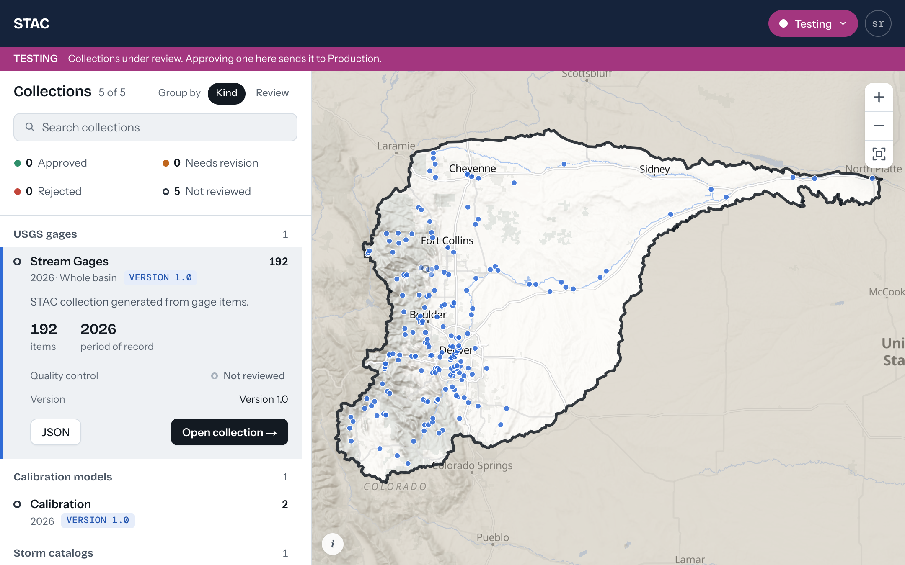

# stac-x

A STAC viewer for FFRD's Colorado data. It reads static STAC catalogs and
stac-geoparquet files, from S3 or local folders, draws every collection on a
map of the South Platte basin, and lets a reviewer record QC on each
collection. Approving a collection copies its files into the next environment
(Development to Test, Test to Production).

It writes two things. QC decisions go to a JSON sidecar beside the
collection's file (`gages.parquet` gets `gages.edits.json`), never into the
parquet itself, and a promoted collection is copied byte for byte into the
next environment's first source.



## Running it

Install [Node.js](https://nodejs.org) 20 or newer. On WSL, install Node
inside the Linux distro rather than using the Windows install.

Install dependencies:

```bash
npm install
```

Start the dev server:

```bash
npm run dev
```

Open http://localhost:3000, which lands in Development. Reading the S3
catalogs needs AWS credentials with access to the `south-platte` bucket.
Without them the pages still load, empty, with a note that collections
couldn't be loaded.

There's no identity provider yet. The sign-in page is a stand-in that opens
Development whatever you type, and the account shown is a fixed role.

For a demo, build for production and serve that instead, so pages don't
compile on first click:

```bash
npm run build
```

```bash
npm start
```

Lint and typecheck:

```bash
npm run lint
```

```bash
npm run typecheck
```

## Docker image

Every push to `main` builds the image and publishes it to GitHub's container
registry as `ghcr.io/dewberry/stac-x:main` (see
`.github/workflows/docker.yml`). Tagging a release `v1.2.3` also publishes
`1.2.3`, `1.2` and `latest`.

To run the app from a local build instead of the dev server:

```bash
docker build -t stac-x .
docker run --rm -p 3000:3000 --env-file .env stac-x
```

The container reads the same variables as `.env.example`. Local sources
(`./data/prod` by default) live at `/app/data` inside the container and are
lost when it stops, so mount the repo's `data` folder there to keep the
collections promoted into Production and their QC edits, the same place the
dev server writes them. Edits to collections read from S3 go to S3 sidecars
either way:

```bash
docker run --rm -p 3000:3000 --env-file .env -v "$PWD/data:/app/data" stac-x
```

To run the published image, log in to ghcr.io first. The repo is private, so
this needs a classic GitHub token with `read:packages`:

```bash
echo $GITHUB_TOKEN | docker login ghcr.io -u <github-user> --password-stdin
docker run --rm -p 3000:3000 --env-file .env ghcr.io/dewberry/stac-x:main
```

The image is a production build with no hot reload, so keep using `npm run dev`
for day-to-day work and reach for the container to check what actually ships.

## Environment variables

Make a `.env` file from the example. In PowerShell:

```powershell
Copy-Item .env.example .env
```

In WSL:

```bash
cp .env.example .env
```

Set `STAC_SOURCES_SANDBOX`, `STAC_SOURCES_DEV`, `STAC_SOURCES_TEST` and
`STAC_SOURCES_PROD` to where each environment's files live: a STAC `catalog.json`, an S3 prefix, one
object, a local folder, or a local file, separated by commas. A prefix or
folder is read for every parquet file and `catalog.json` in it. A catalog is
followed through its `child` links to its collections, and each collection's
items are the JSON files its `item` links point at or, when it has none, the
rows of the parquet file it links to.

There are no defaults in the code: an environment left unset reads nothing
and its pages load empty. The example file points Sandbox at `./data/sandbox`,
Development at `s3://south-platte/stac-metadata/catalog.json`, whose items are
JSON, Test at `s3://south-platte/stac-portable/catalog.json`, whose
collections each link to a parquet file, and Production at `./data/prod`.
Sandbox sits outside promotion: approving a collection there records the
decision and copies nothing, and nothing is promoted into it. Promotion copies
parquet files, so a collection whose items are JSON can't be sent on yet.
AWS credentials come from the SDK's usual chain: `AWS_PROFILE`, env keys, or
an instance role. `.env.example` explains each variable.
